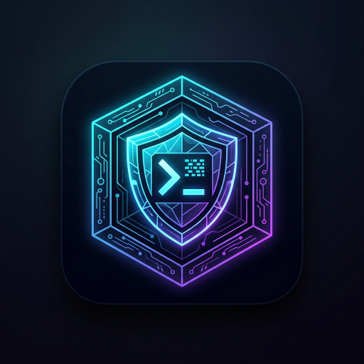

# Untrusted VM

[](https://android.com)
[](https://github.com/UntrustedGuy/Untrusted-VM)
[](https://github.com/UntrustedGuy/Untrusted-VM)

<p align="center">
  
</p>

**Untrusted VM** is an Android virtualization and sandboxing container platform inspired by VMOS Pro. It allows running isolated guest Android userland environments on stock, unrooted Android devices **without requiring Shizuku, physical device root, or host-level kernel modifications**.

Each virtual machine instance operates in a dedicated, multi-process Android service (`:vms01`, `:vms02`, etc.) and features an independent, per-instance **Simulated Root Option**.

---

## Key Features

- **No Shizuku / No Host Root Required**: Runs entirely in unprivileged Android application space. The host operating system remains 100% stock, secure, and unmodified.
- **Per-Instance Simulated Root Toggle**:
  - Each VM instance can independently toggle Root access on or off in VM Settings.
  - When enabled: Provisions simulated `/system/xbin/su` inside the guest filesystem, updates `build.prop` (`ro.build.tags=test-keys`, `ro.debuggable=1`), and grants guest UID 0 to guest apps requesting superuser permissions.
  - When disabled: Completely unlinks and masks the `su` binary from the guest environment, returning clean `release-keys` properties to pass guest integrity and root detection checks.
- **Multi-Process Architecture (`:vms01` - `:vms04`)**:
  - Emulates VMOS Pro's multi-process isolation model.
  - Container crashes inside a guest environment do not bring down the main host UI process.
  - IPC communication handled via AIDL interfaces (`IVmService`, `IVmCallback`).
- **Modern Jetpack Compose Dark Theme UI**:
  - High-tech cybernetic dark theme with deep obsidian backgrounds, neon cyan, electric purple, and emerald root accents.
  - Instance cards with quick status indicators, RAM allocation, and instant root toggles.
  - Built-in Root Terminal shell to execute and verify guest commands (`id`, `su`, `getprop`, `which su`).
  - Floating navigation overlay for the virtual screen viewport.

---

## Architecture Overview

```
Untrusted VM Application
├── Host UI Process (untrusted.vm)
│   ├── MainActivity (Jetpack Compose Dark Theme)
│   ├── VmManager (Instance Lifecycle Orchestrator)
│   └── DashboardScreen / VmSettingsScreen / TerminalScreen
│
├── Multi-Process Container Services
│   ├── :vms01 (untrusted.vm.service.VmService01)
│   ├── :vms02 (untrusted.vm.service.VmService02)
│   └── :vms03 / :vms04
│
└── Per-Instance Storage Sandbox (/data/user/0/untrusted.vm/instances/vm_N/)
    ├── config.json (Instance configuration & root state)
    ├── rootfs/
    │   ├── system/
    │   │   ├── bin/sh
    │   │   ├── xbin/su (Present when Root is ENABLED, absent when DISABLED)
    │   │   └── build.prop
    │   ├── data/ (Guest application and user data)
    │   └── sdcard/
    └── logs/ & snapshots/
```

---

## Simulated Root Mechanism (VMOS Pro Model)

Unlike standard Android where root requires flashing Magisk or patching boot images, Untrusted VM's guest environment runs as a userspace container:

1. **Guest UID Virtualization**: Within the container sandbox, guest processes execute under the host app's normal Linux UID, but the container's VFS and syscall layer reports `uid=0(root)` to guest processes requesting root.
2. **Dynamic `/system/xbin/su` Provisioning**:
   - `RootController.setRootState(true)` writes the executable `su` wrapper into the guest's isolated `xbin` directory.
   - When a guest app calls `Runtime.getRuntime().exec("su")`, the command succeeds and spawns an elevated guest shell session.
   - Toggling the root switch off immediately wipes `/system/xbin/su`, leaving the guest clean for apps that require unrooted environments.

---

## License

Copyright (c) 2026 UntrustedGuy. All rights reserved.
